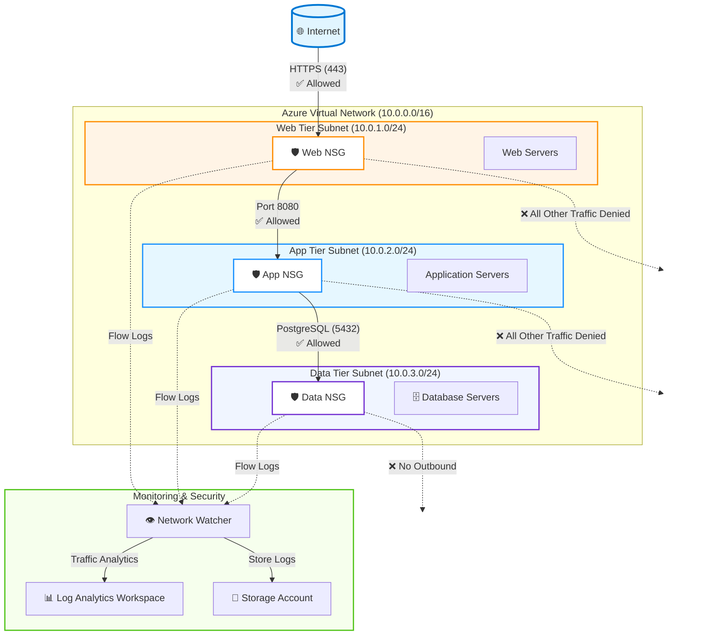

# Azure Zero Trust Network Segmentation

This Terraform configuration implements a zero-trust network architecture on Azure with strict network segmentation and comprehensive audit logging.

## Architecture Overview

### Network Design



### Traffic Flow Rules

| Source | Destination | Protocol | Port | Action | Purpose |
|--------|-------------|----------|------|--------|---------|
| Internet | Web Tier | TCP | 443 | ✅ **Allow** | HTTPS traffic to web frontend |
| Web Tier | App Tier | TCP | 8080 | ✅ **Allow** | Web to application communication |
| App Tier | Data Tier | TCP | 5432 | ✅ **Allow** | PostgreSQL database queries |
| Web Tier | Data Tier | Any | Any | ❌ **Deny** | No direct web-to-database access |
| Data Tier | Any | Any | Any | ❌ **Deny** | Database isolation (no outbound) |
| All Others | All Others | Any | Any | ❌ **Deny** | Default deny-all policy |

## Zero Trust Principles Implemented

### 1. **Least Privilege Access**
- Each tier only allows specific protocols and ports
- Default deny-all rules enforce explicit allow requirements
- Unidirectional traffic flow (web → app → data)

### 2. **Network Segmentation**
- Three isolated subnets for each application tier
- Network Security Groups (NSGs) enforce micro-segmentation
- No direct access between web and data tiers

### 3. **Explicit Deny Rules**
- Each NSG includes explicit deny-all rules at priority 4096
- Ensures no implicit Azure default rules bypass security controls
- Defense-in-depth approach

### 4. **Audit and Compliance**
- NSG Flow Logs enabled on all three tiers
- Traffic Analytics integration with Log Analytics
- 30-day retention for compliance requirements
- Version 2 flow logs with enhanced metadata

## Resources Deployed

### Core Network
- **Resource Group**: Container for all resources
- **Virtual Network**: 10.0.0.0/16 address space
- **Subnets**: Three subnets for web, app, and data tiers

### Security Controls
- **Network Security Groups (3)**: One per tier with explicit rules
- **NSG Rules (12)**: Allow and deny rules implementing zero-trust model
- **NSG Associations (3)**: Link NSGs to respective subnets

### Monitoring & Audit
- **Log Analytics Workspace**: Centralized logging platform
- **Storage Account**: Flow log storage with encryption
- **Network Watcher**: Required for flow log functionality
- **NSG Flow Logs (3)**: One per NSG with Traffic Analytics enabled

## Network Security Group Rules

### Web Tier NSG
| Priority | Direction | Access | Protocol | Port | Source | Destination | Purpose |
|----------|-----------|--------|----------|------|--------|-------------|---------|
| 100 | Inbound | Allow | TCP | 443 | Internet | 10.0.1.0/24 | HTTPS from Internet |
| 4096 | Inbound | Deny | * | * | * | * | Deny all other inbound |
| 100 | Outbound | Allow | TCP | 8080 | 10.0.1.0/24 | 10.0.2.0/24 | Forward to App tier |
| 4096 | Outbound | Deny | * | * | * | * | Deny all other outbound |

### App Tier NSG
| Priority | Direction | Access | Protocol | Port | Source | Destination | Purpose |
|----------|-----------|--------|----------|------|--------|-------------|---------|
| 100 | Inbound | Allow | TCP | 8080 | 10.0.1.0/24 | 10.0.2.0/24 | From Web tier |
| 4096 | Inbound | Deny | * | * | * | * | Deny all other inbound |
| 100 | Outbound | Allow | TCP | 5432 | 10.0.2.0/24 | 10.0.3.0/24 | Database access |
| 4096 | Outbound | Deny | * | * | * | * | Deny all other outbound |

### Data Tier NSG
| Priority | Direction | Access | Protocol | Port | Source | Destination | Purpose |
|----------|-----------|--------|----------|------|--------|-------------|---------|
| 100 | Inbound | Allow | TCP | 5432 | 10.0.2.0/24 | 10.0.3.0/24 | PostgreSQL from App |
| 4096 | Inbound | Deny | * | * | * | * | Deny all other inbound |
| 4096 | Outbound | Deny | * | * | * | * | Database isolation |

## Usage

### Prerequisites
- Azure CLI installed and authenticated
- Terraform >= 1.5.0 installed
- Appropriate Azure subscription permissions

### Deployment Steps

1. **Initialize Terraform**
   ```bash
   terraform init
   ```

2. **Review the Plan**
   ```bash
   terraform plan
   ```

3. **Deploy Infrastructure**
   ```bash
   terraform apply
   ```

4. **Verify Deployment**
   ```bash
   # List deployed resources
   az network vnet show --name zerotrust-dev-vnet --resource-group zerotrust-dev-rg

   # View NSG rules
   az network nsg show --name web-nsg --resource-group zerotrust-dev-rg

   # Check flow log status
   az network watcher flow-log show --name web-nsg-flow-log --resource-group zerotrust-dev-rg
   ```

### Customization

You can override default values using variables:

```bash
terraform apply \
  -var="location=westus2" \
  -var="environment=prod" \
  -var="log_analytics_retention_days=90"
```

Or create a `terraform.tfvars` file:

```hcl
location                     = "westus2"
environment                  = "production"
project_name                 = "myapp"
log_analytics_retention_days = 90
```

## Security Best Practices Applied

### Azure Well-Architected Framework Alignment

#### Security Pillar
- ✅ Network segmentation with NSGs
- ✅ Explicit deny rules for defense-in-depth
- ✅ Least privilege network access
- ✅ Audit logging with NSG flow logs
- ✅ TLS 1.2 minimum for storage accounts
- ✅ HTTPS-only storage account access

#### Reliability Pillar
- ✅ Centralized logging for incident response
- ✅ Traffic analytics for anomaly detection

#### Operational Excellence Pillar
- ✅ Infrastructure as Code with Terraform
- ✅ Comprehensive tagging strategy
- ✅ Log retention for compliance

#### Cost Optimization Pillar
- ✅ LRS storage for flow logs (appropriate for dev)
- ✅ Configurable retention periods
- ✅ Single Log Analytics workspace

## Monitoring and Audit

### Viewing NSG Flow Logs

Flow logs are stored in two locations:

1. **Storage Account**: Raw flow log data
   ```bash
   az storage blob list \
     --account-name zerotrustdevflowlogs \
     --container-name insights-logs-networksecuritygroupflowevent
   ```

2. **Log Analytics**: Queryable via KQL
   ```kql
   AzureNetworkAnalytics_CL
   | where SubType_s == "FlowLog"
   | where TimeGenerated > ago(1h)
   | project TimeGenerated, FlowDirection_s, DestPort_d, DestIP_s, SrcIP_s, AllowedOutFlows_d
   ```

### Traffic Analytics Queries

Access Traffic Analytics in Azure Portal:
1. Navigate to Network Watcher → Traffic Analytics
2. View dashboards showing:
   - Top talkers
   - Blocked flows
   - Traffic patterns
   - Anomaly detection

### Setting Up Alerts

Create alerts for security events:

```bash
# Alert on denied traffic
az monitor metrics alert create \
  --name "NSG-Denied-Traffic" \
  --resource-group zerotrust-dev-rg \
  --scopes /subscriptions/{sub-id}/resourceGroups/zerotrust-dev-rg \
  --condition "count NetworkSecurityGroupEvent where Action == 'Deny'" \
  --window-size 5m \
  --evaluation-frequency 1m
```

## Terraform Outputs

After deployment, these values are available:

```bash
terraform output
```

| Output | Description |
|--------|-------------|
| `resource_group_name` | Name of the resource group |
| `vnet_id` | Virtual Network resource ID |
| `web_subnet_id` | Web tier subnet ID |
| `app_subnet_id` | App tier subnet ID |
| `data_subnet_id` | Data tier subnet ID |
| `web_nsg_id` | Web NSG resource ID |
| `app_nsg_id` | App NSG resource ID |
| `data_nsg_id` | Data NSG resource ID |
| `log_analytics_workspace_id` | Log Analytics workspace ID |
| `flow_logs_storage_account_id` | Flow logs storage account ID |

## Cost Estimates

Approximate monthly costs (East US, pay-as-you-go):

| Resource | Estimated Cost |
|----------|----------------|
| Virtual Network | Free |
| Network Security Groups | Free |
| Storage Account (LRS, 10GB) | ~$0.20 |
| Log Analytics (10GB ingestion) | ~$25.00 |
| Network Watcher flow logs | ~$0.50 |
| **Total** | **~$25.70/month** |

*Note: Costs vary based on actual traffic volume and retention settings.*

## Cleanup

To destroy all resources:

```bash
terraform destroy
```

**Warning**: This will permanently delete all resources including flow logs.

## Architecture Decisions

### Why Explicit Deny Rules?

Azure NSGs have built-in default rules that allow VNet-to-VNet traffic. Explicit deny rules at priority 4096 ensure:
- No reliance on default Azure rules
- Clear security intent in code
- Easier security audits
- Compliance with zero-trust requirements

### Why No Public IPs?

This configuration intentionally omits public IP addresses and internet gateways:
- Production deployments should use Azure Application Gateway or Azure Front Door
- Bastion hosts or VPN gateways provide admin access
- Aligns with zero-trust "never trust, always verify" principle

### Why Traffic Analytics?

Traffic Analytics provides:
- ML-based anomaly detection
- Geographic traffic visualization
- Protocol and application insights
- Security threat detection
- Compliance reporting

## Next Steps

1. **Deploy Application Components**: Use these subnet IDs to deploy VMs, App Services, or AKS
2. **Add Application Gateway**: Front the web tier with Azure Application Gateway + WAF
3. **Implement Azure Bastion**: Provide secure RDP/SSH access without public IPs
4. **Enable Azure Defender**: Add Microsoft Defender for Cloud integration
5. **Configure Azure Policy**: Enforce NSG rules organization-wide
6. **Implement Private Endpoints**: Access Azure PaaS services over private network

## Compliance Mappings

This configuration supports:

- **NIST 800-53**: SC-7 (Boundary Protection), AU-6 (Audit Review)
- **CIS Azure Benchmarks**: 6.1-6.6 (Networking)
- **PCI DSS**: Requirement 1 (Firewalls), Requirement 10 (Logging)
- **ISO 27001**: A.13.1 (Network Security)

## References

- [Azure Network Security Groups](https://learn.microsoft.com/azure/virtual-network/network-security-groups-overview)
- [NSG Flow Logs](https://learn.microsoft.com/azure/network-watcher/network-watcher-nsg-flow-logging-overview)
- [Traffic Analytics](https://learn.microsoft.com/azure/network-watcher/traffic-analytics)
- [Azure Well-Architected Framework - Security](https://learn.microsoft.com/azure/well-architected/security/)

## Support

For issues or questions:
1. Check Terraform plan output for errors
2. Review Azure Activity Log for deployment failures
3. Verify service principal permissions
4. Consult Azure Network Watcher for connectivity issues

---

**Version**: 1.0
**Last Updated**: December 2025
**Terraform Version**: >= 1.5.0
**Azure Provider Version**: ~> 3.80
